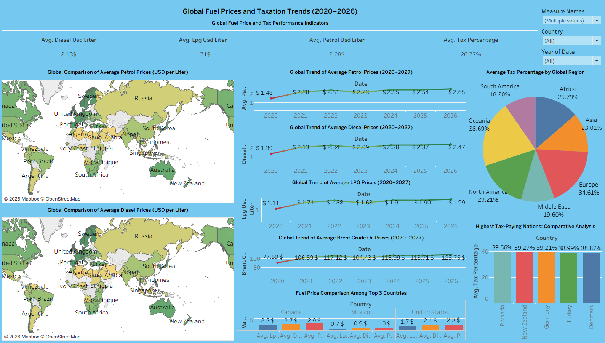

# Global Fuel Prices and Taxation Trends (2020–2026)

An interactive Tableau dashboard analyzing global fuel price fluctuations (Petrol, Diesel, LPG, and Brent Crude Oil) and regional taxation benchmarks across 80+ nations.

---

## 📊 Live Interactive Dashboard
👉 **[View the Live Interactive Dashboard on Tableau Public](https://public.tableau.com/views/GlobalFuelPricesandTaxationTrends/Sheet9-10?:language=en-US&:sid=&:redirect=auth&:display_count=n&:origin=viz_share_link)**

---

## 🖼️ Dashboard Preview


---

## 📌 Project Overview
* **Data Granularity:** Weekly fuel pricing data across countries from 2020 to 2026.
* **Core KPI Metrics:**
  * Average Diesel Price: **$2.13 / L**
  * Average LPG Price: **$1.71 / L**
  * Average Petrol Price: **$2.28 / L**
  * Average Global Tax Percentage: **26.77%**

## 🔍 Key Dashboard Features
1. **Global Choropleth Maps:** Geospatial comparison of worldwide petrol and diesel pricing.
2. **Trend Forecasting (2020–2027):** Time-series analysis utilizing Tableau's native forecasting engine to project fuel prices and Brent crude index.
3. **Regional Tax Distribution:** Proportional breakdown of tax levies across continents.
4. **Highest Tax-Paying Nations:** Ranked comparative analysis of top taxation jurisdictions (Rwanda, New Zealand, Germany, Turkey, Denmark).
5. **North American Regional Comparison:** Grouped price distribution across Canada, Mexico, and the United States.

---

## 🛠️ Tools & Technologies
* **Tableau Desktop / Public**
* **Data Manipulation & Analysis:** Python (`pandas`)
* **Data Source:** `global_fuel_prices_Dataset.csv`

---

## 🚀 How to Run Locally
1. Clone this repository:
   ```bash
   git clone [https://github.com/Mayank2502190-J2369/global-fuel-prices-tableau.git](https://github.com/Mayank2502190-J2369/global-fuel-prices-tableau.git)
